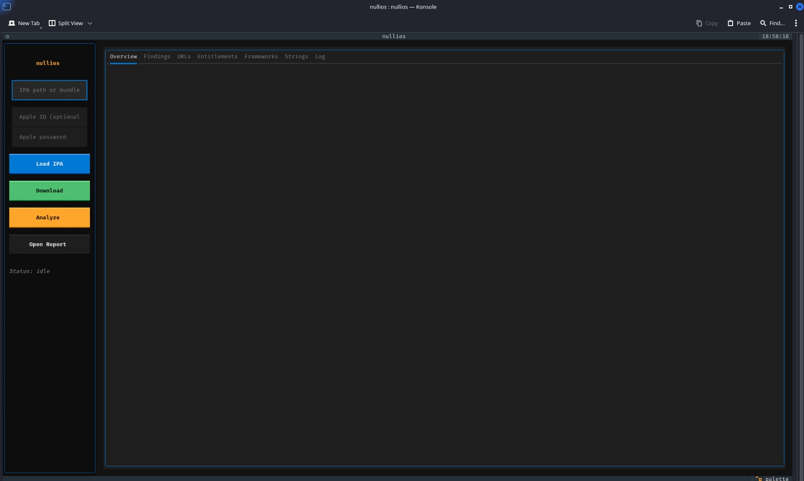

# nullios

iOS application acquisition and static analysis workbench for bug bounty researchers.



## Install

```bash
cd nullios
python -m venv .venv
source .venv/bin/activate
pip install -e ".[store]"
```

## Usage

Launch the TUI:

```bash
nullios
```

Analyze a local IPA headlessly:

```bash
nullios /path/to/app.ipa
```

Download from the App Store (requires credentials):

```bash
export NULLIOS_APPLE_ID="you@example.com"
export NULLIOS_APPLE_PASSWORD="your-password"
nullios com.example.app
```

You can also pass credentials directly in the TUI via the **Apple ID** and **Apple password** input fields.

## What it does

- Extracts IPA bundles and parses `Info.plist`
- Detects URL schemes, universal links, and associated domains
- Evaluates App Transport Security settings
- Reads entitlements from `embedded.mobileprovision`
- Inspects Mach-O binary protections (PIE, stack canary, ARC, encryption)
- Extracts interesting strings (URLs, tokens, JWT-like patterns)
- Lists frameworks, dylibs, and permissions
- Generates Markdown and JSON reports

## Acquiring IPAs without an Apple ID

App Store downloads **require** a valid Apple ID; there is no supported way to bypass this. If you do not want to use your personal account, you can still analyze an app with any of the following IPA sources:

| Source | Notes |
|--------|-------|
| **Local IPA file** | A `.ipa` you already have on disk. This is the fastest path. |
| **Decrypted jailbreak dump** | Jailbroken devices can produce decrypted binaries for full static analysis. |
| **Developer/Enterprise distribution** | Some vendors distribute signed `.ipa` files directly (e.g., internal betas). |
| **Xcode build** | Open-source iOS apps can be built and archived as `.ipa` locally. |
| **TestFlight** | Still requires an Apple account, but you may use a dedicated research account. |

### Local-only quick start (no account needed)

```bash
# Just point nullios at an .ipa file
nullios /path/to/app.ipa -o ./reports
```

### Metadata-only lookup (no download)

You can resolve a bundle ID or App Store URL to basic metadata using the public iTunes lookup API without credentials, but a full analysis still needs the actual IPA:

```python
from nullios.store import resolve_target
print(resolve_target("https://apps.apple.com/us/app/example/id123456789"))
```

## Optional dependencies

- `ipatool-py` or the `ipatool` CLI for App Store downloads
- `rabin2` from radare2 for deeper binary summaries
- `codesign` on macOS for entitlement extraction from the binary

## Notes

App Store IPAs are encrypted. Static analysis of the main binary requires a decrypted dump from a jailbroken device. nullios will still analyze metadata, entitlements, and strings from the container.
